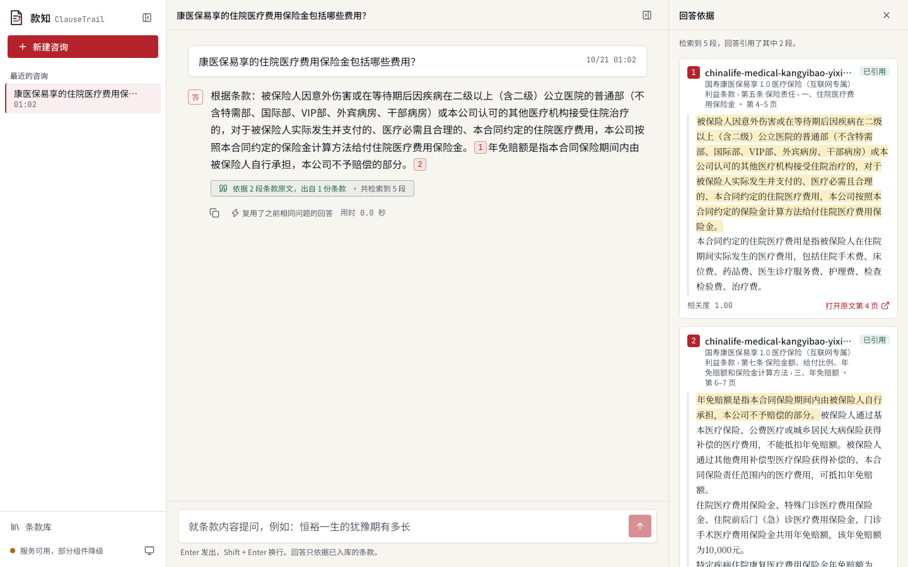
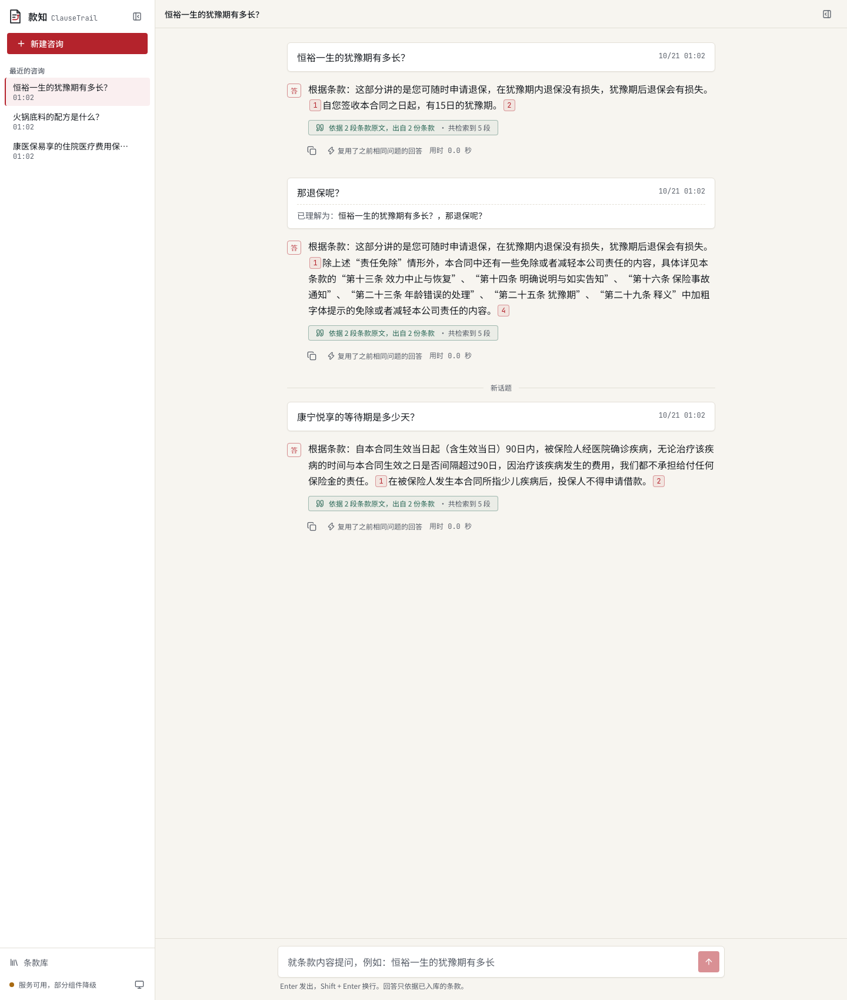
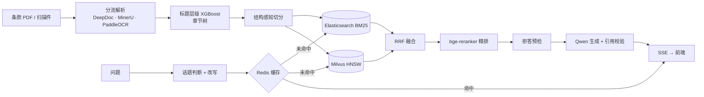

# 款知 ClauseTrail

保险条款问答：每个回答都能追到条款原文的章节和页码；找不到依据时直接说找不到。

[](LICENSE)


[English](README.en.md)



<details>
<summary>多轮对话：显示「已理解为」和话题切换</summary>



</details>

截图仅作示例，界面和交互与接入阿里云模型时相同。

## 技术栈

| 环节 | 组件 |
| --- | --- |
| 服务 | Python 3.12、FastAPI（异步）、SSE 流式输出 |
| 解析 | DeepDoc（版面分析、表格结构识别、OCR）、MinerU、PaddleOCR、OpenCV、pdfplumber |
| 结构 | XGBoost 标题层级分类、jieba + 保险术语词典 |
| 检索 | Milvus（HNSW 向量）、Elasticsearch（BM25 + 同义词）、RRF 融合 |
| 模型 | bge-m3（向量）、bge-reranker-large（精排）、Qwen（改写 / 生成） |
| 缓存与存储 | Redis（查询缓存）、SQLite（文档、会话、知识库版本） |
| 前端 | React 19、TanStack Router / Query、shadcn/ui、Tailwind CSS 4、Vite |

模型默认走阿里云：bge-m3 部署在 PAI-EAS，精排用 OpenSearch 托管的 BGE 重排服务（`ops-bge-reranker-larger`），Qwen 走百炼。也可以改用本地 FlagEmbedding 加载 bge-m3 和 bge-reranker-large。

## 功能

- **解析分流**：原生 PDF 用 DeepDoc 做版面分析；无边框表格交给 MinerU，未安装时用 DeepDoc TSR；扫描件先经 OpenCV 去噪、纠偏，再交给 PaddleOCR，未安装时用 DeepDoc OCR。
- **章节结构**：XGBoost 判断标题层级，按编号样式出现的先后建章节树；OCR 结果用术语词典和形近字表纠错。
- **结构感知切分**：按章节递归切分，责任免除清单和但书不会被拆开。每个片段都带章节路径、页码和版面框。
- **混合检索**：bge-m3 向量（Milvus HNSW）和 BM25（Elasticsearch，jieba 加 571 条保险术语分词，同义词扩展）并行召回，经 RRF 融合，取前 20 条用 bge-reranker 精排，前 5 条作为证据进入 Prompt。
- **有出处的回答**：Qwen 流式生成，每句标注引用编号。召回分数不够，或回答对不上原文时，直接拒答。
- **多轮对话**：先判断话题是否延续，再把追问改写成独立问句；记忆用滑窗加摘要。
- **查询缓存**：Redis 的 key 由归一化问句和知识库版本号组成，文档更新后旧缓存自动失效。
- **评测**：评测集由合成加自动校验得到，开发集和测试集按文档隔离。指标包括 MRR@10、Recall@k、截断率、改写准确率和引用准确率。

## 架构



各模块的细节见 [docs/architecture.md](docs/architecture.md)。

## 快速开始

需要 Python 3.12、Node.js 24、[uv](https://docs.astral.sh/uv/) 和 GNU Make。

```bash
git clone https://github.com/LvvUP/clausetrail.git && cd clausetrail
cp .env.example .env   # 填入阿里云密钥；没有密钥时把三个 *_BACKEND 改成 fake
make setup             # 创建 Python 虚拟环境，安装前端依赖
make models            # 下载 DeepDoc 模型（约 100 MB）
make demo              # 入库样例 → 跑评测 → 启动 API（:8000）和前端（:5173）
```

仓库不附带任何 API Key。为了不注册账号也能看到完整链路，也为了公开仓库里不出现密钥，截图和测试都使用离线示例实现（三个 `*_BACKEND` 设为 `fake`）。它不调用任何外部服务，能跑通解析、检索、拒答和流式输出，但回答只用来演示流程。想看检索和回答的实际效果，欢迎在 `.env` 里填上自己的阿里云 API Key 动手试试：`.env.example` 默认就是阿里云后端，`.env` 已在 `.gitignore` 里，不会被提交。向量和精排也可以改用本地模型（`local`），条款也可以换成你自己的。

不开前端，也可以在命令行里试。先 `make ingest`；Milvus Lite 的数据文件同一时间只能被一个进程打开，API 在运行时先停掉它：

```bash
backend/.venv/bin/clausetrail search "恒裕一生的犹豫期有多长"       # 看向量、BM25、RRF、精排各自的排名，不调用生成模型
backend/.venv/bin/clausetrail ask "恒裕一生解除合同要提供哪些资料"  # 流式输出回答，末尾列出引用的文件、章节和页码
backend/.venv/bin/clausetrail health                                # 各组件当前用的后端和状态
```

需要依赖服务时，用 `docker compose --profile full up -d` 启动 Redis、Elasticsearch 和 Milvus standalone，再把 `VECTOR_STORE_URI` 改成 `http://localhost:19530`。其他运行方式见 [docs/deployment.md](docs/deployment.md)。

## 目录

| 路径 | 内容 |
| --- | --- |
| `backend/src/clausetrail/ingest/` | 按页分流：原生 PDF、无边框表格、扫描件 |
| `backend/src/clausetrail/structure/` | OCR 纠错、标题层级分类、章节树 |
| `backend/src/clausetrail/chunking/` | 结构感知切分与合并规则 |
| `backend/src/clausetrail/index/` | Milvus 向量 + BM25（Elasticsearch / Milvus） |
| `backend/src/clausetrail/retrieval/` | 并行召回、RRF、精排 |
| `backend/src/clausetrail/answer/` | Prompt、引用校验、拒答 |
| `backend/src/clausetrail/conversation/` | 话题判断、改写、记忆 |
| `backend/src/clausetrail/models/` | 向量 / 精排 / 大模型：阿里云 API、本地模型、离线示例实现 |
| `backend/src/clausetrail/corpus/` | 公开条款目录遍历与下载（`clausetrail corpus`） |
| `backend/resources/` | 保险术语词典、同义词、形近字表、标题层级模型 |
| `backend/scripts/` | 训练标题层级模型、生成术语表、下载模型 |
| `backend/third_party/deepdoc/` | DeepDoc 视觉推理代码（Apache-2.0，见 NOTICE） |
| `frontend/` | React + TanStack Router / Query + shadcn/ui + Tailwind，Vite 构建 |
| `eval/` | 评测集合成、指标、报告 |
| `data/samples/` | 4 份公开条款样例 + 1 份合成扫描件 |
| `docs/` | 架构、部署、评测、数据来源 |

## 配置

全部配置写在 `.env` 里，完整列表和格式说明见 [.env.example](.env.example)。

| 类别 | 变量 |
| --- | --- |
| 模型后端 | `EMBEDDER_BACKEND`、`RERANKER_BACKEND`、`LLM_BACKEND`（`aliyun_*` / `local` / `fake`） |
| 阿里云 | `ALIYUN_PAI_EAS_*`、`ALIYUN_OPENSEARCH_*`、`ALIYUN_BAILIAN_*`、`LLM_REWRITE_MODEL`、`LLM_ANSWER_MODEL` |
| 检索 | `VECTOR_STORE_URI`、`BM25_BACKEND`、`ES_URL`、`RECALL_TOP_K`、`RRF_K`、`RERANK_TOP_K`、`CONTEXT_TOP_K` |
| 拒答与缓存 | `REFUSAL_THRESHOLD`（在开发集上标定）、`REDIS_URL` |

## 评测

```bash
make eval    # 标定 → 检索 → 改写 → 引用 → 切分，报告写到 eval/reports/
```

下载多少份条款、怎样划分评测集，都可以按自己的需要决定。生成脚本默认按文档 2:8 划分开发集和测试集，两者不共享文档，开发集只用来调参；这只是建议比例，可以在 `eval/gen/corpus.py` 里调整。用法见 [docs/evaluation.md](docs/evaluation.md)，报告在本地生成，不提交到仓库。

## 数据来源

保险公司官网的公开信息披露栏目公开了在售和停售产品的条款。2026-10-22 逐条遍历平安人寿、中国人寿、新华保险、太保寿险四家的目录，共 4,886 个产品、5,902 份条款文件（含已停用的历史版本）；中国保险行业协会财产险产品库另有约 14,000 个产品。仓库里只放少量样例，不包含语料本体。来源清单和计数方式见 [docs/data-sources.md](docs/data-sources.md) 和 [data/corpus_manifest.csv](data/corpus_manifest.csv)。

### 下载全量语料（可选）

只用仓库里的样例就能跑通全部流程。想在更大规模上复现时，可以用 `clausetrail corpus` 从上面四家官网下载条款 PDF：

```bash
make corpus                                                # 遍历四家官网目录，写出 data/corpus/manifest.csv（只请求目录页，约 20 分钟）
backend/.venv/bin/clausetrail corpus check                 # 每家抽查几条链接，确认返回的是 PDF（不落盘）
backend/.venv/bin/clausetrail corpus download --limit 100  # 先下载 100 份试试；不带参数时默认只下载 20 份
backend/.venv/bin/clausetrail corpus download --all        # 下载清单里的全部条款文件，保存在 data/corpus/files/
backend/.venv/bin/clausetrail ingest data/corpus/files     # 入库
```

- 对官网保持克制：同一站点每秒最多一个请求，遵守 robots.txt，只保存确认是 PDF 的文件。中断后重跑会跳过已下载的文件；某一家连续失败 10 份时先停下这一家；磁盘剩余低于 2 GB 时自动停止（`--min-free-gb` 可调）。
- 全部下载约 5,900 份、按样例的文件大小估算几个 GB，按每秒一个请求需要几个小时。`data/corpus/` 已加入 `.gitignore`。
- 各站点的目录结构是 2026-10-22 核实的。官网改版后对应来源可能失效，`corpus list` 会报出是哪一家，其余来源照常写入清单。
- 条款是保险公司按监管要求公开披露的文件，版权归各保险公司所有。脚本只访问公开页面；下载的文件请仅用于个人研究和学习，不要再分发或商用，并遵守各网站的使用条款。
- 用阿里云模型入库全量语料需要较长时间和相应的 API 费用。

## 局限

- 仓库只带 4 份条款样例，全量语料用 `clausetrail corpus` 下载（见「下载全量语料」）。
- 扫描件样例是合成数据。MinerU 和 PaddleOCR 的适配代码已经写好，但默认不安装。
- API 没有认证。对外提供服务时，需要放在带认证的反向代理后面。

## 免责声明

本项目仅用于技术研究与演示。问答结果不构成保险建议，以保险合同原文和保险公司的解释为准。样例条款的版权归各保险公司所有，见 [data/samples/README.md](data/samples/README.md)。

## License

[Apache-2.0](LICENSE)。`backend/third_party/deepdoc` 包含源自 InfiniFlow/ragflow 的代码，见 [NOTICE](NOTICE)。参与贡献见 [CONTRIBUTING.md](CONTRIBUTING.md)。
